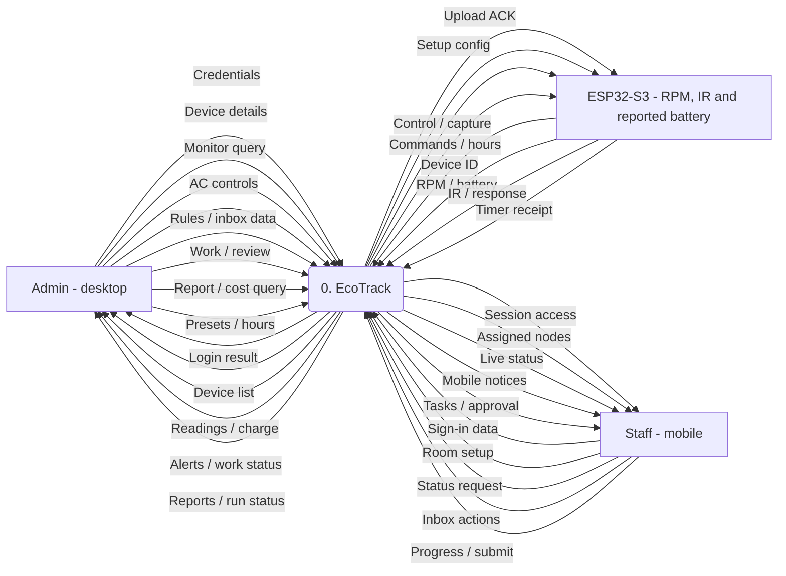
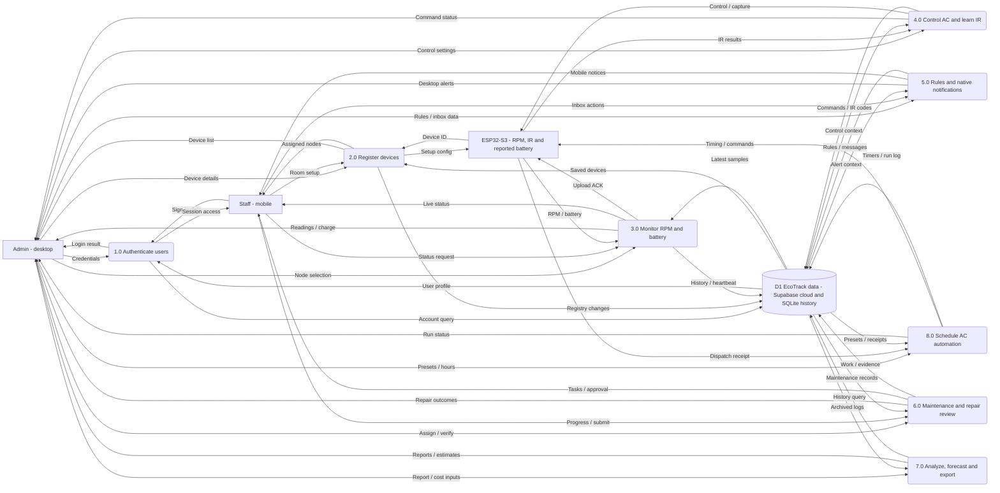

# EcoTrack data flow diagrams

Updated 6 November 2026. Logical DFDs cover the desktop administrator, assigned mobile staff and ESP32 hardware. D1 groups related cloud and desktop history records. Level 1 adds timed AC automation and updates battery, notification and repair-review flows using the current source.

## Level 0 - context

<!-- mermaid:id=level_0 -->

## Level 1 - decomposition

<!-- mermaid:id=level_1 -->

